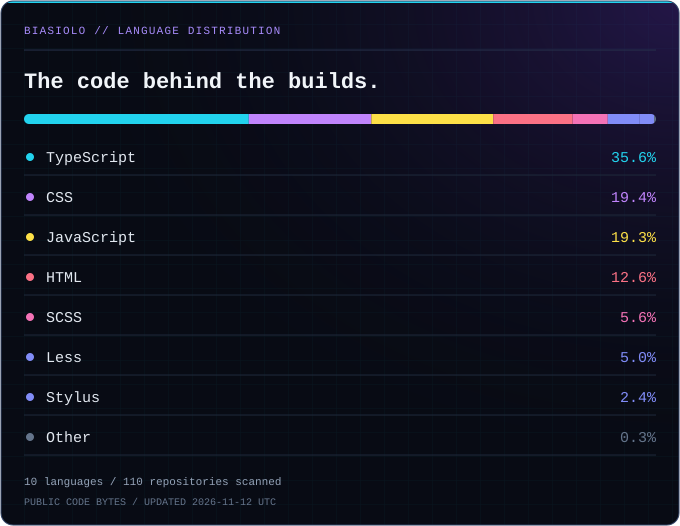

<!-- ═══════════════════ BIASIOLO / PROFILE ═══════════════════ -->

<p align="center">
  
</p>

<p align="center">
  <code>⌘ CODE</code>
  &nbsp; × &nbsp;
  <code>◈ DESIGN</code>
  &nbsp; × &nbsp;
  <code>↗ PRODUCT</code>
</p>

<p align="center">
  
</p>

<p align="center">
  Building digital products with a creative mind<br />
  and an eye for the details that make them feel right.
</p>

<br />

<p align="center">
  <a href="https://portfolio-rafael-biasiolo.vercel.app/">
    
  </a>
  <a href="https://www.linkedin.com/in/rafael-biasiolo/">
    
  </a>
  <a href="mailto:biasiolorafael@gmail.com">
    
  </a>
</p>

<p align="center">
  <a href="#01--identity">Identity</a>
  &nbsp; / &nbsp;
  <a href="#02--toolkit">Toolkit</a>
  &nbsp; / &nbsp;
  <a href="#03--selected-builds">Builds</a>
  &nbsp; / &nbsp;
  <a href="#05--telemetry">Telemetry</a>
  &nbsp; / &nbsp;
  <a href="#07--connect">Connect</a>
</p>

<br />

<!-- ═══════════════════════ IDENTITY ═══════════════════════ -->

## 01 / Identity


```yaml
name: Rafael Biasiolo
role: Web Developer

focus:
  - Front-end development
  - Interface design
  - Digital products

approach: Connect code, design, and business thinking.
```

I turn creative concepts into **functional, intuitive digital experiences** — from focused landing pages to dynamic web applications.

My work brings together **development, UI/UX, SEO, and marketing**. I care about understanding the product, shaping the experience, and building the details that help people use it naturally.

I built and launched **ShoppToolz** and **BrainDex**, connecting technical development, creative design, and business thinking.

> A thoughtful interface makes complex things feel simple.

<br />

<table>
  <tr>
    <td width="33%" valign="top">
      <code>⌘ / ENGINEER</code>
      <h3>Build the experience.</h3>
      <p>Responsive layouts, application logic, and purposeful interactions.</p>
    </td>
    <td width="33%" valign="top">
      <code>◈ / DESIGN</code>
      <h3>Make it feel right.</h3>
      <p>Clear hierarchy, intuitive navigation, and visual consistency.</p>
    </td>
    <td width="33%" valign="top">
      <code>↗ / CONNECT</code>
      <h3>Think beyond the UI.</h3>
      <p>Connect implementation with usability, discovery, and product goals.</p>
    </td>
  </tr>
</table>

<br />

<!-- ═══════════════════════ TOOLKIT ═══════════════════════ -->

## 02 / Toolkit


Tools I use to move from concept to implementation.

<br />

**`[ APPLICATION CORE ]`**

<p>
  
  
  
  
  
</p>

**`[ INTERFACE LAYER ]`**

<p>
  
  
  
  
  
</p>

**`[ CREATIVE WORKFLOW ]`**

<p>
  
  
  
</p>

<br />

<!-- ═══════════════════════ BUILDS ═══════════════════════ -->

## 03 / Selected Builds


Products I built and launched through development, design, and business thinking.

<br />

<table>
  <tr>
    <td width="50%" valign="top">
      
      <h3>SHOPPTOOLZ</h3>
      <p>
        A platform I built and launched, bringing together
        technical development, creative design, and product thinking.
      </p>
      <p>
        <code>DEVELOPMENT</code>
        <code>DESIGN</code>
        <code>LAUNCH</code>
      </p>
      <br />
      <a href="https://shopptoolz.com">
        
      </a>
    </td>
    <td width="50%" valign="top">
      
      <h3>BRAINDEX</h3>
      <p>
        A product taken from concept to launch through web development,
        interface design, and attention to the user experience.
      </p>
      <p>
        <code>DEVELOPMENT</code>
        <code>DESIGN</code>
        <code>LAUNCH</code>
      </p>
      <br />
      <a href="https://braindex.fun">
        
      </a>
    </td>
  </tr>
</table>

<p align="right">
  <a href="https://portfolio-rafael-biasiolo.vercel.app/">
    <b>View the full portfolio ↗</b>
  </a>
</p>

<br />

<!-- ═══════════════════════ SOURCE ═══════════════════════ -->

## 04 / Source Code


<table>
  <tr>
    <td width="50%" valign="top">
      <code>REPO / 001</code>
      <h3>YooChat!</h3>
      <a href="https://github.com/Biasiolo/chatbot">
        
      </a>
    </td>
    <td width="50%" valign="top">
      <code>REPO / 002</code>
      <h3>Dev Tips</h3>
      <a href="https://github.com/Biasiolo/dev-tips">
        
      </a>
    </td>
  </tr>
</table>

<p align="right">
  <a href="https://github.com/Biasiolo?tab=repositories">
    Browse all repositories ↗
  </a>
</p>

<br />

<!-- ═══════════════════════ TELEMETRY ═══════════════════════ -->

## 05 / Telemetry


Repositories, languages, and contributions — the data behind the builds.

<p>
  <a href="https://github.com/Biasiolo/Biasiolo/actions/workflows/profile-metrics.yml">
    
  </a>
</p>

<br />

<p align="center">
  
</p>

<p align="center">
  <sub>PROFILE / REPOSITORIES / CONTRIBUTIONS</sub>
</p>

<p align="center">
  <a href="https://github.com/Biasiolo">
    
  </a>
</p>

<br />

<p align="center">
  
</p>

<p align="center">
  <sub>THE CODE BEHIND THE PROJECTS</sub>
</p>

<p align="center">
  
</p>

<p align="center">
  <sub>
    Based on code volume in public repositories.<br />
    Language distribution reflects repository composition, not proficiency.
  </sub>
</p>

<br />

<p align="center">
  
</p>

<p align="center">
  <sub>ANNUAL CONTRIBUTIONS / RECENT PUBLIC EVENTS</sub>
</p>

<p align="center">
  <a href="https://github.com/Biasiolo?tab=overview">
    
  </a>
</p>

<p align="center">
  <sub>
    Generated with GitHub Actions · SVG assets stored in this repository
  </sub>
</p>

<br />

<!-- ═══════════════════════ PROCESS ═══════════════════════ -->

## 06 / Build Sequence


```text
[01] DISCOVER
     Understand the people, the problem, and the goal.
       │
[02] DESIGN
     Shape the structure, visuals, and interactions.
       │
[03] DEVELOP
     Build a responsive, functional experience.
       │
[04] CONNECT
     Bring usability, SEO, and marketing into the product.
       │
[05] REFINE
     Learn, iterate, and improve the experience.
```

<br />

<!-- ═══════════════════════ CONTACT ═══════════════════════ -->

## 07 / Connect


Have an idea worth building? Let’s talk about it.

<br />

<p align="center">
  <a href="mailto:biasiolorafael@gmail.com">
    
  </a>
</p>

<p align="center">
  <a href="https://www.linkedin.com/in/rafael-biasiolo/">
    
  </a>
  <a href="https://portfolio-rafael-biasiolo.vercel.app/">
    
  </a>
</p>

<br />

---

<p align="center">
  <code>THOUGHTFUL INTERFACES / USEFUL PRODUCTS / ALWAYS LEARNING</code>
</p>

<p align="center">
  <sub>Rafael Biasiolo · Code with purpose. Design with intent.</sub>
</p>

<p align="center">
  
</p>
